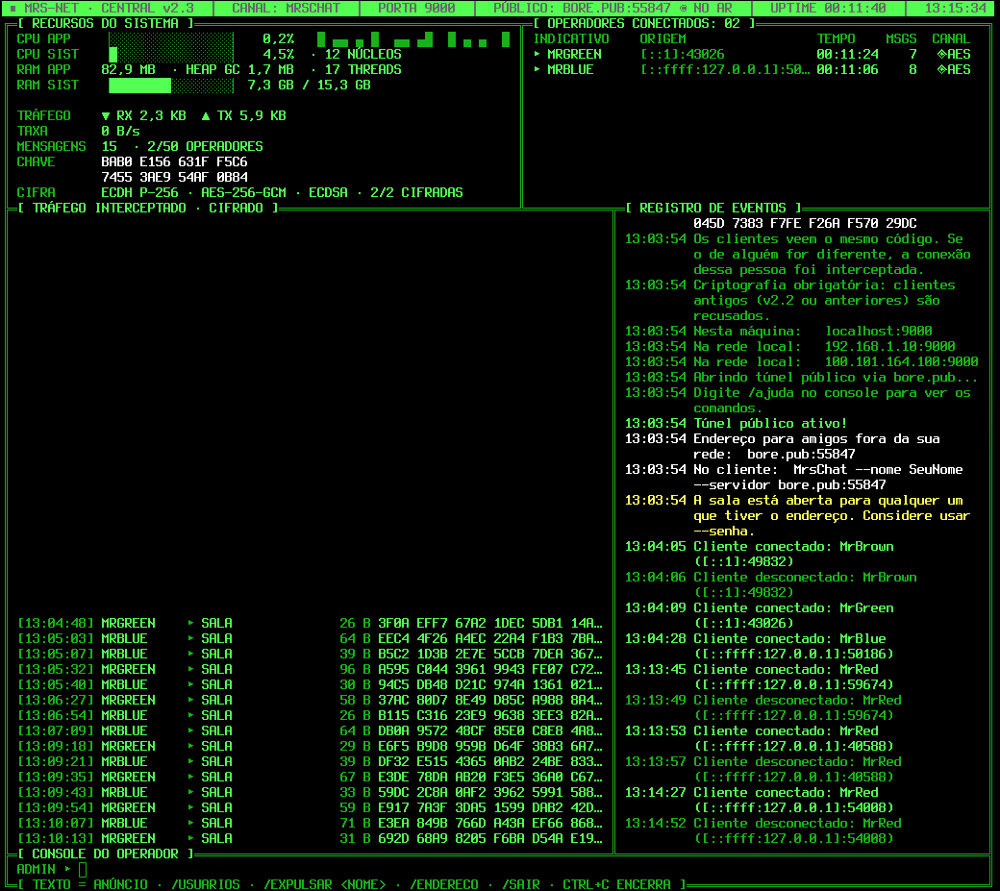

#  MrsChatServer

**MrsChatServer** é um aplicativo servidor que tem como objetivo hospedar uma sala para vários clientes MRS poderem conversar, podem ser adiquiridos [neste meu outro repositório](https://github.com/FlaipyTheHost/MrsChat).

# 

## Novidades da v2.3

- **Criptografia obrigatória** entre clientes e servidor (ECDH P-256 + AES-256-GCM, com a identidade do servidor assinando a troca de chaves). O relay do `--publico` e qualquer um no caminho não leem nem alteram as mensagens.
- **Chave de identidade** criada na primeira execução (`MrsChatServer.chave`). A impressão digital aparece no painel; os clientes mostram o mesmo código para todos compararem.
- **Painel de central de comunicação**: CPU e RAM do app e do sistema, tráfego em KB com gráfico, operadores conectados, tráfego recente **só em bytes cifrados** e registro de eventos.
- A tela do servidor nunca mostra o texto das mensagens, nem no modo `--simples`.


### Sobre a criptografia

É uma criptografia **entre cada cliente e o servidor**, não ponta a ponta: o servidor decifra para repassar as mensagens. O painel esconde o conteúdo, mas quem controla o processo do servidor poderia, tecnicamente, ler. Proteções:

- Ninguém no caminho (rede, Wi-Fi, relay bore) consegue ler, alterar, repetir ou reordenar mensagens: qualquer linha adulterada derruba a conexão.
- Os clientes guardam a chave de cada servidor e recusam a conexão se ela mudar (como o SSH).
- **Guarde o arquivo `MrsChatServer.chave`**: ele é a identidade do servidor. Se ele for apagado, outro é criado e os clientes vão avisar que a chave mudou.
- Clientes antigos (v2.2 ou anteriores) não sabem cifrar e são recusados. Para aceitá-los mesmo assim, use `--aceitar-sem-cripto`; a sala é avisada e o tráfego deles vai em texto puro.

## Novidades da v2.1

- Nome da sala com `--sala`, exibido no cabeçalho do cliente MrsChat v2.1, que também usa o servidor para preencher o painel de integrantes.

## Novidades da v2.0

- **Acesso pela internet com `--publico`**, sem abrir porta no roteador. Funciona atrás de NAT e CGNAT.
- **Interface de linha de comando** com opções (`--porta`, `--senha`, `--publico`...) e `--ajuda`.
- **Console de administração**: anúncios, `/usuarios`, `/expulsar`, `/endereco`.
- **Senha opcional** para a sala, limite de usuários e nomes únicos.
- **Comandos para os clientes**: `/usuarios`, `/msg`, `/nick`, `/me`.
- Correções: mensagens enviadas juntas não se misturam mais, um cliente lento não trava os outros, escuta em IPv4 e IPv6.
- Continua **compatível com o cliente MrsChat v1.0**.

## Instalação

É necessário ter o **.NET 8 ou mais novo** (o app usa a versão mais nova que encontrar, então o .NET 10 também serve).

**Windows:** instale o runtime pelo [site da Microsoft](https://dotnet.microsoft.com/pt-br/download/dotnet/8.0) e execute o `MrsChatServer.exe` das [releases](https://github.com/FlaipyTheHost/MrsChatServer/releases/).

**Ubuntu/Mint/Debian:**
```
sudo apt install dotnet-runtime-8.0
```

**Fedora:**
```
sudo dnf install dotnet-runtime-8.0
```

Depois extraia o zip das [releases](https://github.com/FlaipyTheHost/MrsChatServer/releases/) e rode:
```
unzip MrsChatServer_x64_Release_*.zip
dotnet MrsChatServer.dll
```

## Uso

```
dotnet MrsChatServer.dll [opções]
```

| Opção | Descrição |
|---|---|
| `-p`, `--porta <n>` | Porta TCP local (padrão: 9000) |
| `--sala <nome>` | Nome da sala mostrado aos clientes (padrão: MrsChat) |
| `--senha <texto>` | Exige senha para entrar na sala |
| `--max-clientes <n>` | Limite de usuários (padrão: 50) |
| `--publico` | Abre um túnel público via `bore.pub` |
| `--relay <host[:porta]>` | Usa outro relay bore (ex.: um VPS seu) |
| `--relay-segredo <s>` | Segredo do relay, se ele exigir |
| `--porta-publica <n>` | Pede uma porta específica no relay |
| `--chave <arquivo>` | Chave de identidade (padrão: `MrsChatServer.chave`, criada se não existir) |
| `--aceitar-sem-cripto` | Aceita também clientes antigos, sem criptografia |
| `--simples` | Log linha a linha em vez do painel (bom para rodar como serviço) |
| `-h`, `--ajuda` | Mostra a ajuda |

A forma antiga `dotnet MrsChatServer.dll 9000` continua funcionando. Tudo também pode ficar no `MrsChatServer.conf`, e os argumentos têm prioridade sobre ele.

## Jogando com amigos fora da sua rede

Na rede local, basta passar o IP que o servidor mostra ao iniciar (ex.: `192.168.0.10:9000`).

Para amigos em outras redes:

```
dotnet MrsChatServer.dll --publico --senha minhasenha
```

O servidor mostra algo como:

```
Túnel público ativo!
  Endereço para amigos fora da sua rede:  bore.pub:41234
```

Seus amigos conectam nesse endereço:

```
dotnet MrsChat.dll --nome MrBlue --servidor bore.pub:41234 --senha minhasenha
```

**Como funciona:** o servidor abre uma conexão de *saída* até o relay [bore](https://github.com/ekzhang/bore), que passa a aceitar conexões numa porta pública e repassá-las para o seu PC. Como a conexão parte de dentro da sua rede, não é preciso redirecionar porta no roteador, e funciona mesmo com CGNAT. O protocolo do bore está implementado no próprio servidor, sem nada para instalar.

**Observações:**
- O `bore.pub` é um serviço público e gratuito, mantido pelo autor do bore, sem garantia de disponibilidade. Se cair, o servidor tenta reconectar sozinho e, quando possível, mantém o mesmo endereço.
- Qualquer pessoa com o endereço consegue tentar entrar, então use `--senha`.
- Se você tiver um VPS, pode rodar seu próprio relay (`bore server --secret xyz`) e usar `--relay meuvps.com --relay-segredo xyz`.
- Conexões pelo túnel aparecem no log como vindas de `127.0.0.1`.

## Console do servidor

Com o servidor rodando, digite no terminal:

| Comando | Descrição |
|---|---|
| `<texto>` | Envia um anúncio para todos |
| `/usuarios` | Lista quem está online |
| `/expulsar <nome> [motivo]` | Remove alguém da sala |
| `/endereco` | Mostra o endereço público |
| `/sair` | Encerra o servidor (ou Ctrl+C) |
